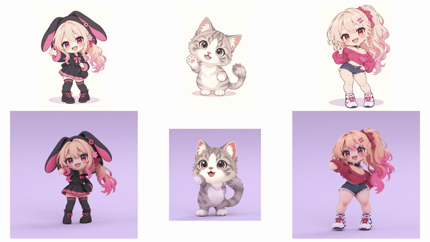

# FX Games

FX Games makes game assets with [Grida FX](https://github.com/gridaco/fx). Its workflows are
general: each turns a small input into a named deliverable, such as a transparent idle loop, a
rigged 3D character or a set of repeating parallax layers, and is an FX workflow you can plan,
run and inspect. Every workflow plans offline, with its price, before any spend, and most reuse
a node cache across runs. Inspect runs in FX's viewer, which
`uv run python -m grida.fx start --open` opens. Your application decides how the assets become
a game, an animation or a tool.


_[Iron Petal Unit](godot/games/iron_petal_unit/README.md), one of the example games built with FX Games assets._

## Workflows

Each workflow is one folder under `src/fx_games/workflows/` with its declaration, page,
contract and examples. This table is checked against each folder's `workflow.toml`.

<!-- workflows:begin -->
| Workflow | Id | Promise |
| --- | --- | --- |
| [3D character](src/fx_games/workflows/character_3d/page.mdx) | `character-3d` | One written brief in. One rigged, reviewed character out. |
| [Looping parallax](src/fx_games/workflows/looping_parallax/page.mdx) | `looping-parallax` | Layer pictures in. Repeating layers and their scroll placement out. |
| [Movie sprite](src/fx_games/workflows/movie_sprite/page.mdx) | `movie-sprite` | One character picture in. A transparent idle loop out. |
| [Portrait motion](src/fx_games/workflows/portrait_motion/page.mdx) | `portrait-motion` | One finished sprite in. Eyes and mouth a game can drive separately out. |
| [Universe](src/fx_games/workflows/universe/page.mdx) | `universe` | A poster, a synopsis and a direction in. A reviewed storyworld and one concept image per entity out. |
<!-- workflows:end -->




The [3D character](src/fx_games/workflows/character_3d/page.mdx) and
[movie sprite](src/fx_games/workflows/movie_sprite/page.mdx) workflows made these; the
[preview notes](.github/assets/readme/README.md) say how.

## Install and try it

Python 3.12 or newer and [uv](https://docs.astral.sh/uv/) are required. Grida FX, the engine,
is a submodule at `third_party/fx`, which `uv sync` installs from: clone with
`--recurse-submodules`, or run `git submodule update --init` once. Its engine is Rust and needs
cargo (from [rustup.rs](https://rustup.rs)); build it again after a pull that moves the pin.
From this checkout:

```sh
git submodule update --init
uv sync --frozen
uv run python third_party/fx/tools/build_engine.py
uv run python -m grida.fx schema looping-parallax
uv run python src/fx_games/workflows/looping_parallax/inputs/supplied_layers/make_inputs.py out/looping-parallax-input
uv run python -m grida.fx plan looping-parallax --inputs out/looping-parallax-input/inputs.yaml
uv run python -m grida.fx run looping-parallax --inputs out/looping-parallax-input/inputs.yaml
uv run python -m grida.fx inspect looping-parallax --verify
uv run python -m grida.fx start --open
```

That run is offline: committed scripts draw the input layers, and no provider is called.
Every workflow is an FX workflow file, and the root `fx.yaml` finds each by its id, so
`python -m grida.fx` plans, runs and inspects it; `schema <id>` prints the inputs it takes.
Run folders are under `out/runs/` and results in the store, `out/fx-cache`. Planning never
spends; a provider call needs `--live`, a ceiling (`--max-usd`) and your own keys (see
[provider setup](docs/models/providers.md)). Your own workflow is a workflow file or a Python
builder, which `python -m grida.fx plan` and `run` take the same way; the
[FX guide](https://github.com/gridaco/fx/tree/main/docs/guide) shows how to write one.

## Read more

- [Getting started](docs/getting-started.md), the
  [FX guide](https://github.com/gridaco/fx/tree/main/docs/guide) and the [glossary](docs/glossary.md).
- [Site](docs/site.md): the static landing and documentation site built from the catalog
  and the example store.
- [Architecture](ARCHITECTURE.md), the [documentation index](docs/README.md), the
  [directory preview](docs/repository-layout.md) and the [contribution guide](CONTRIBUTING.md).
- [Verification](VERIFICATION.md): `uv run python scripts/check.py` is the product gate and
  needs neither Bun nor Godot. Source licensing is distinct from asset rights; see
  [media publication](docs/generated-media-publication.md).
- Agent skills: [game concept studio](skills/game-concept-studio/SKILL.md) and
  [movie poster](skills/movie-poster/SKILL.md), installed with
  `npx skills add softmarshmallow/fx-games --skill <name>`.

## Godot example project

The repository also houses a separately owned consumer product, the
[Godot example project](godot/README.md): its [example games](godot/games/README.md),
runtime packages, templates and tools show ways to use FX Games assets, under its own
[charter](godot/CHARTER.md). Games own their scenes, controls, narrative and asset wiring;
FX Games requires no game or gameplay contract.
